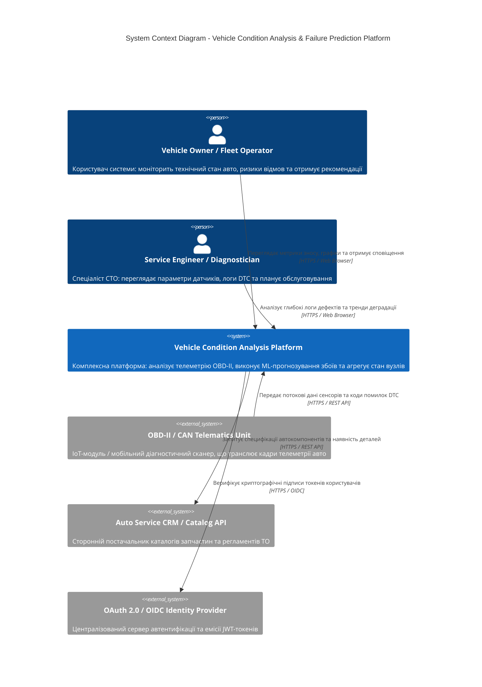
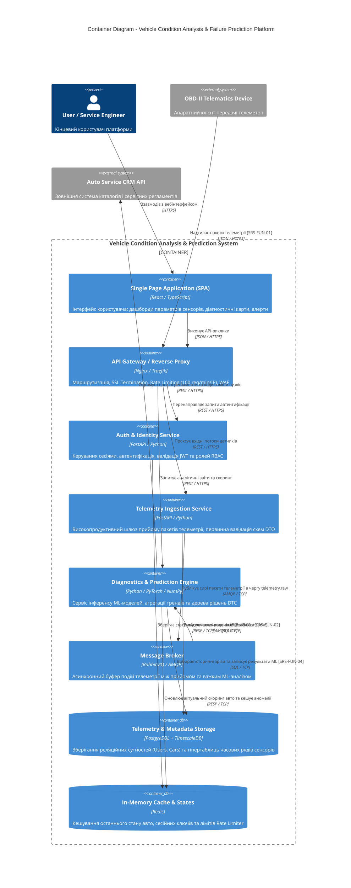

# Розділ 2. Проєктування архітектури системи

## 2.1. Контекстне та контейнерне моделювання системи (C4 Model)

### Діаграма контексту системи (Level 1 - System Context)
Вхідні потоки даних та актори взаємодіють із платформою відповідно до меж, специфікованих у [SRS (Розділ 1: System Context)](./srs.md#1-system-context-контекст-системи).

#### Технічний опис зв'язків контекстного рівня:
* **Клієнтські виклики:** Власники авто та інженери звертаються до платформи через зашифровані канали `HTTPS / TLS 1.3` відповідно до вимоги безпеки [SRS-NFR-SEC-02](./srs.md#3-non-functional-requirements-матриця-нефункціональних-вимог).
* **Телематичний потік:** Апаратні модулі OBD-II транслюють телеметрію по протоколу `HTTPS / REST API` із JSON-корисним навантаженням за контрактом [SRS-FUN-01](./srs.md#2-functional-requirements-функціональні-вимоги).
* **Зовнішні провайдери:** Інтеграція з `OAuth 2.0 / OIDC` виконується через стандартизовані протоколи автентифікації за вимогою [SRS-NFR-SEC-01](./srs.md#3-non-functional-requirements-матриця-нефункціональних-вимог).

---

### Діаграма контейнерів системи (Level 2 - Container Diagram)
Система розділена на окремі виконувані контейнери для ізоляції високонавантаженого потоку запису телеметрії від обчислювального аналізу даних.

#### Технічний опис контейнерів та протоколів:
* **API Gateway (Nginx/Traefik):** Периметровий вузол безпеки, що виконує SSL Termination, захист від DDoS через Rate Limiting (100 req/min/IP) та балансування навантаження, забезпечуючи виконання [SRS-NFR-PERF-01](./srs.md#3-non-functional-requirements-матриця-нефункціональних-вимог).
* **Telemetry Ingestion Service:** Асинхронний сервіс на базі `FastAPI`, призначений для високошвидкісного прийому пакетів телеметрії, валідації `JSON Schema` [SRS-FUN-01](./srs.md#2-functional-requirements-функціональні-вимоги) та паралельного запису в чергу `RabbitMQ`.
* **Message Broker (RabbitMQ):** Декуплює вхідний потік від обчислювального блоку аналітики за протоколом `AMQP / TCP`, що гарантує відсутність втрати телеметрії при сплесках трафіку.
* **База даних TimescaleDB:** Реалізує гібридне колоночне сховище за архітектурним рішенням [ADR-001](./adr/0001-choice-of-technology.md) та вимогою [SRS-FUN-02](./srs.md#2-functional-requirements-функціональні-вимоги) через протокол `SQL / TCP`.

---

## 2.2. Компонентне моделювання критичного сервісу системи (C4 Model: Component)

Для поглибленої декомпозиції обрано ключовий аналітичний сервіс бекенду: **Diagnostics & Failure Prediction Engine** (`FastAPI` / `Python` / `PyTorch`).

```mermaid
C4Component
    title Component Diagram - Diagnostics & Failure Prediction Engine

    Container(api_gw, "API Gateway", "Nginx / Reverse Proxy", "Шлюз вхідного трафіку системи")
    Container(broker, "Message Broker", "RabbitMQ", "Черга вхідних телематичних пакетів")
    ContainerDb(ts_db, "TimescaleDB", "PostgreSQL", "Сховище часових рядів та доменних сутностей")
    ContainerDb(redis_cache, "Redis Cache", "In-Memory", "Гарячий кеш станів вузлів")

    Container_Boundary(engine, "Diagnostics & Failure Prediction Engine") {
        Component(jwt_guard, "JWT & Scope Guard", "FastAPI Dependency / Security", "Перевіряє криптографічний підпис токена та права доступу ролі [SRS-NFR-SEC-01]")
        Component(err_handler, "Global Exception Handler", "FastAPI Middleware", "Перехоплює помилки домену та трансформує їх у RFC 7807 Problem Details")
        Component(metrics, "Prometheus Telemetry Collector", "Prometheus Client", "Збирає лічильники викликів, помилок та квантилі часу інференсу")
        
        Component(api_controller, "Diagnostics REST Controller", "FastAPI APIRouter", "Обробляє зовнішні запити на отримання звітів та скорингу авто")
        Component(amqp_consumer, "Telemetry Stream Consumer", "Aio-pika / Task Worker", "Вичитує пачки кадрів телеметрії з RabbitMQ у неблокуючому режимі")
        
        Component(dto_validator, "DTO Validation & Normalizer", "Pydantic v2", "Здійснює строгу типізацію, очищення та відсіювання некоректних сенсорних викидів")
        Component(prediction_coord, "Prediction Coordinator", "Domain Service", "Координує бізнес-сценарій: оркеструє завантаження вікна даних, ML-аналіз та генерацію рекомендацій")
        Component(dtc_analyzer, "DTC Fault Tree Engine", "Domain Service", "Зіставляє коди помилок за графом залежностей систем автомобіля (DTC Graph) [SRS-FUN-03]")
        Component(ml_inference, "Failure Prediction Model Runner", "PyTorch / ONNX Runtime", "Виконує прямий прохід (inference) моделі виявлення деградації за часовими вікнами [SRS-FUN-04]")
        
        Component(ts_repo, "Telemetry Data Repository", "SQLAlchemy 2.0 (Async)", "Шар доступу до часових рядів сенсорів та збереження розрахованого ризику")
        Component(cache_client, "State Cache Client", "Redis-py (Async)", "Адаптер збереження обчислених скоринг-станів авто у кеші")
    }

    Rel(api_gw, jwt_guard, "Передає HTTP-запити на аналітику", "REST / HTTPS")
    Rel(jwt_guard, api_controller, "Пропускає валідований контекст виклику", "Internal Call")
    Rel(api_controller, err_handler, "Охоплюється перехоплювачем збоїв", "AOP / Interceptor")
    Rel(api_controller, metrics, "Реєструє HTTP-метрики", "Internal In-Memory")

    Rel(broker, amqp_consumer, "Доставляє повідомлення telemetry.raw", "AMQP / TCP")
    Rel(amqp_consumer, dto_validator, "Передає сирі батчі даних", "Internal Call")
    Rel(dto_validator, prediction_coord, "Передає валідовані доменні сутності", "Internal Call")

    Rel(api_controller, prediction_coord, "Викликає розрахунок або читання стану", "Dependency Injection")
    
    Rel(prediction_coord, dtc_analyzer, "Ініціює аналіз ланцюгів несправностей", "Method Call")
    Rel(prediction_coord, ml_inference, "Передає нормалізований тензор часового вікна", "Memory Tensor Pointer")
    Rel(prediction_coord, ts_repo, "Отримує ретроспективне вікно сенсорів та пише прогноз", "Async Interface")
    Rel(prediction_coord, cache_client, "Кешує актуальний індекс здоров'я авто", "Async Interface")

    Rel(ts_repo, ts_db, "Виконує оптимізовані агрегаційні SQL-запити", "Asyncpg / TCP")
    Rel(cache_client, redis_cache, "Записує розраховані структури станів", "RESP / TCP")
```

#### Технічний опис компонентів та принципів Clean Architecture:
* **Вхідний шар (Inbound Layer):** `JWT & Scope Guard` перевіряє права доступу [SRS-NFR-SEC-01](./srs.md#3-non-functional-requirements-матриця-нефункціональних-вимог) до виклику бізнес-методів. `Telemetry Stream Consumer` вичитує події з черги за допомогою асинхронного клієнта `aio-pika`.
* **Шар доменної логіки (Domain Core):**
  * `DTO Validation & Normalizer` здійснює відсіювання шумів сенсорів через `Pydantic v2` під контракт [SRS-FUN-01](./srs.md#2-functional-requirements-функціональні-вимоги).
  * `Prediction Coordinator` оркеструє бізнес-процес без прямої прив'язки до баз даних (патерн *Dependency Inversion*).
  * `Failure Prediction Model Runner` оптимізовано через середовище `ONNX Runtime`, що забезпечує виконання вимоги інференсу $\le 50$ мс [SRS-NFR-PERF-03](./srs.md#3-non-functional-requirements-матриця-нефункціональних-вимог).
* **Шар інфраструктури (Outbound Layer):** `Telemetry Data Repository` реалізує патерн `Repository` через асинхронний драйвер `asyncpg`, ізолюючи формування SQL-запитів до TimescaleDB згідно з [ADR-001](./adr/0001-choice-of-technology.md).

---

## 2.3. Документування архітектурних рішень (Architecture Decision Records)
* [ADR-001: Вибір архітектури сховища даних для часових рядів телеметрії та діагностичних подій](./adr/0001-choice-of-technology.md) — **Status: Approved**.
