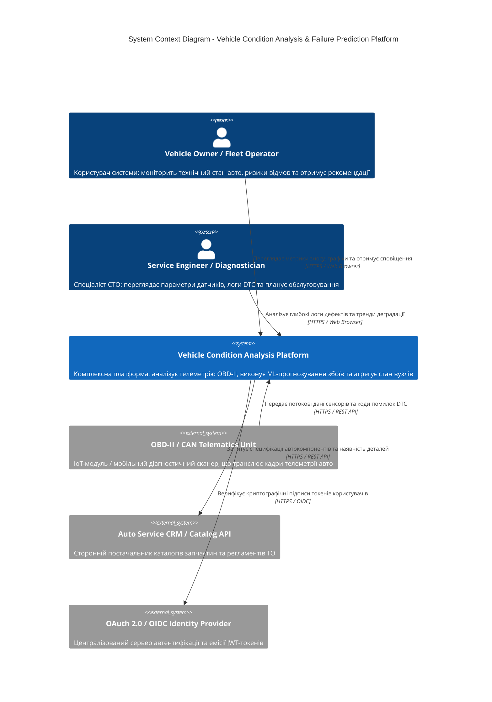
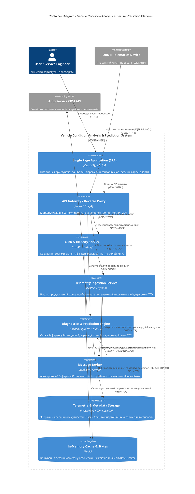
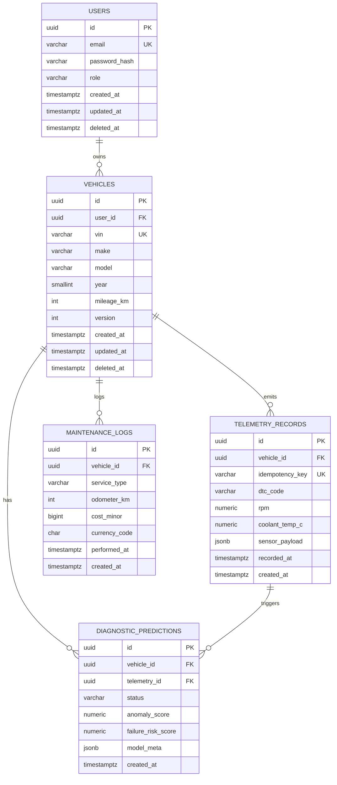
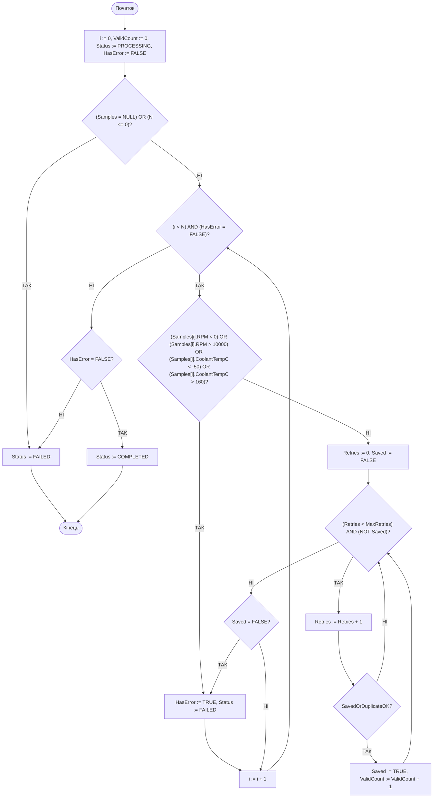
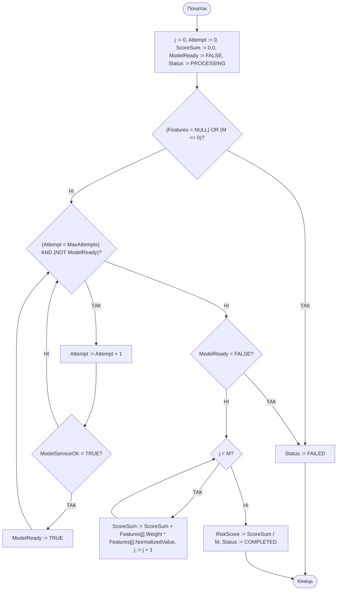

# Розділ 2. Проєктування архітектури системи

## 2.1. Контекстне та контейнерне моделювання системи (C4 Model)

### Діаграма контексту системи (Level 1 - System Context)

Вхідні потоки даних та актори взаємодіють із платформою відповідно до меж, специфікованих у [SRS (Розділ 1: System Context)](./srs.md#1-system-context-контекст-системи).

#### Технічний опис зв'язків контекстного рівня

* **Клієнтські виклики:** Власники авто та інженери звертаються до платформи через зашифровані канали `HTTPS / TLS 1.3` відповідно до вимоги безпеки [SRS-NFR-SEC-02](./srs.md#3-non-functional-requirements-матриця-нефункціональних-вимог).
* **Телематичний потік:** Апаратні модулі OBD-II транслюють телеметрію по протоколу `HTTPS / REST API` із JSON-корисним навантаженням за контрактом [SRS-FUN-01](./srs.md#2-functional-requirements-функціональні-вимоги).
* **Зовнішні провайдери:** Інтеграція з `OAuth 2.0 / OIDC` виконується через стандартизовані протоколи автентифікації за вимогою [SRS-NFR-SEC-01](./srs.md#3-non-functional-requirements-матриця-нефункціональних-вимог).

---

### Діаграма контейнерів системи (Level 2 - Container Diagram)

Система розділена на окремі виконувані контейнери для ізоляції високонавантаженого потоку запису телеметрії від обчислювального аналізу даних.

#### Технічний опис контейнерів та протоколів

* **API Gateway (Nginx/Traefik):** Периметровий вузол безпеки, що виконує SSL Termination, захист від DDoS через Rate Limiting (100 req/min/IP) та балансування навантаження, забезпечуючи виконання [SRS-NFR-PERF-01](./srs.md#3-non-functional-requirements-матриця-нефункціональних-вимог).
* **Telemetry Ingestion Service:** Асинхронний сервіс на базі `FastAPI`, призначений для високошвидкісного прийому пакетів телеметрії, валідації `JSON Schema` [SRS-FUN-01](./srs.md#2-functional-requirements-функціональні-вимоги) та паралельного запису в чергу `RabbitMQ`.
* **Message Broker (RabbitMQ):** Декуплює вхідний потік від обчислювального блоку аналітики за протоколом `AMQP / TCP`, що гарантує відсутність втрати телеметрії при сплесках трафіку.
* **База даних TimescaleDB:** Реалізує гібридне колоночне сховище за архітектурним рішенням [ADR-001](./adr/0001-choice-of-technology.md) та вимогою [SRS-FUN-02](./srs.md#2-functional-requirements-функціональні-вимоги) через протокол `SQL / TCP`.

---

## 2.2. Компонентне моделювання критичного сервісу системи (C4 Model: Component)

Для поглибленої декомпозиції обрано ключовий аналітичний сервіс бекенду: **Diagnostics & Failure Prediction Engine** (`FastAPI` / `Python` / `PyTorch`).

```mermaid
C4Component
    title Component Diagram - Diagnostics & Failure Prediction Engine

    Container(api_gw, "API Gateway", "Nginx / Reverse Proxy", "Шлюз вхідного трафіку системи")
    Container(broker, "Message Broker", "RabbitMQ", "Черга вхідних телематичних пакетів")
    ContainerDb(ts_db, "TimescaleDB", "PostgreSQL", "Сховище часових рядів та доменних сутностей")
    ContainerDb(redis_cache, "Redis Cache", "In-Memory", "Гарячий кеш станів вузлів")

    Container_Boundary(engine, "Diagnostics & Failure Prediction Engine") {
        Component(jwt_guard, "JWT & Scope Guard", "FastAPI Dependency / Security", "Перевіряє криптографічний підпис токена та права доступу ролі [SRS-NFR-SEC-01]")
        Component(err_handler, "Global Exception Handler", "FastAPI Middleware", "Перехоплює помилки домену та трансформує їх у RFC 7807 Problem Details")
        Component(metrics, "Prometheus Telemetry Collector", "Prometheus Client", "Збирає лічильники викликів, помилок та квантилі часу інференсу")
        
        Component(api_controller, "Diagnostics REST Controller", "FastAPI APIRouter", "Обробляє зовнішні запити на отримання звітів та скорингу авто")
        Component(amqp_consumer, "Telemetry Stream Consumer", "Aio-pika / Task Worker", "Вичитує пачки кадрів телеметрії з RabbitMQ у неблокуючому режимі")
        
        Component(dto_validator, "DTO Validation & Normalizer", "Pydantic v2", "Здійснює строгу типізацію, очищення та відсіювання некоректних сенсорних викидів")
        Component(prediction_coord, "Prediction Coordinator", "Domain Service", "Координує бізнес-сценарій: оркеструє завантаження вікна даних, ML-аналіз та генерацію рекомендацій")
        Component(dtc_analyzer, "DTC Fault Tree Engine", "Domain Service", "Зіставляє коди помилок за графом залежностей систем автомобіля (DTC Graph) [SRS-FUN-03]")
        Component(ml_inference, "Failure Prediction Model Runner", "PyTorch / ONNX Runtime", "Виконує прямий прохід (inference) моделі виявлення деградації за часовими вікнами [SRS-FUN-04]")
        
        Component(ts_repo, "Telemetry Data Repository", "SQLAlchemy 2.0 (Async)", "Шар доступу до часових рядів сенсорів та збереження розрахованого ризику")
        Component(cache_client, "State Cache Client", "Redis-py (Async)", "Адаптер збереження обчислених скоринг-станів авто у кеші")
    }

    Rel(api_gw, jwt_guard, "Передає HTTP-запити на аналітику", "REST / HTTPS")
    Rel(jwt_guard, api_controller, "Пропускає валідований контекст виклику", "Internal Call")
    Rel(api_controller, err_handler, "Охоплюється перехоплювачем збоїв", "AOP / Interceptor")
    Rel(api_controller, metrics, "Реєструє HTTP-метрики", "Internal In-Memory")

    Rel(broker, amqp_consumer, "Доставляє повідомлення telemetry.raw", "AMQP / TCP")
    Rel(amqp_consumer, dto_validator, "Передає сирі батчі даних", "Internal Call")
    Rel(dto_validator, prediction_coord, "Передає валідовані доменні сутності", "Internal Call")

    Rel(api_controller, prediction_coord, "Викликає розрахунок або читання стану", "Dependency Injection")
    
    Rel(prediction_coord, dtc_analyzer, "Ініціює аналіз ланцюгів несправностей", "Method Call")
    Rel(prediction_coord, ml_inference, "Передає нормалізований тензор часового вікна", "Memory Tensor Pointer")
    Rel(prediction_coord, ts_repo, "Отримує ретроспективне вікно сенсорів та пише прогноз", "Async Interface")
    Rel(prediction_coord, cache_client, "Кешує актуальний індекс здоров'я авто", "Async Interface")

    Rel(ts_repo, ts_db, "Виконує оптимізовані агрегаційні SQL-запити", "Asyncpg / TCP")
    Rel(cache_client, redis_cache, "Записує розраховані структури станів", "RESP / TCP")
```

### Технічний опис компонентів та принципів Clean Architecture

* **Вхідний шар (Inbound Layer):** `JWT & Scope Guard` перевіряє права доступу [SRS-NFR-SEC-01](./srs.md#3-non-functional-requirements-матриця-нефункціональних-вимог) до виклику бізнес-методів. `Telemetry Stream Consumer` вичитує події з черги за допомогою асинхронного клієнта `aio-pika`.
* **Шар доменної логіки (Domain Core):**
  * `DTO Validation & Normalizer` здійснює відсіювання шумів сенсорів через `Pydantic v2` під контракт [SRS-FUN-01](./srs.md#2-functional-requirements-функціональні-вимоги).
  * `Prediction Coordinator` оркеструє бізнес-процес без прямої прив'язки до баз даних (патерн *Dependency Inversion*).
  * `Failure Prediction Model Runner` оптимізовано через середовище `ONNX Runtime`, що забезпечує виконання вимоги інференсу $\le 50$ мс [SRS-NFR-PERF-03](./srs.md#3-non-functional-requirements-матриця-нефункціональних-вимог).
* **Шар інфраструктури (Outbound Layer):** `Telemetry Data Repository` реалізує патерн `Repository` через асинхронний драйвер `asyncpg`, ізолюючи формування SQL-запитів до TimescaleDB згідно з [ADR-001](./adr/0001-choice-of-technology.md).

---

## 2.3. Документування архітектурних рішень (Architecture Decision Records)

* [ADR-001: Вибір архітектури сховища даних для часових рядів телеметрії та діагностичних подій](./adr/0001-choice-of-technology.md) — **Status: Approved**.

---

## 2.4. Проєктування та моделювання баз даних

Схема зберігання даних узгоджена з [ADR-001](./adr/0001-choice-of-technology.md) та вимогами [SRS](./srs.md) для сховища `PostgreSQL + TimescaleDB`[cite: 3, 4, 5].

* **Індекси та цілісність:** складені `B-Tree` індекси на `TELEMETRY_RECORDS(vehicle_id, recorded_at DESC)` та `DIAGNOSTIC_PREDICTIONS(vehicle_id, status, created_at DESC)`, часткові індекси за `deleted_at IS NULL`, `GIN` на поля `jsonb` (`sensor_payload`, `model_meta`), унікальний `idempotency_key` для ідемпотентної обробки повідомлень.

## 2.5. Специфікація міжсервісних контрактів (API)

Контракт регламентує взаємодію клієнта / OBD-II пристрою через `API Gateway` (`Nginx`) та `API Service` (`FastAPI`) із `Telemetry Ingestion Service` і `Diagnostics & Failure Prediction Engine` (див. [2_design.md](./2_design.md), [SRS](./srs.md) та [ADR-001](./adr/0001-choice-of-technology.md))[cite: 3, 4, 5].

Деталізовану специфікацію ендпоінтів у форматі OpenAPI 3.0 зафіксовано у файлі [openapi.yaml](./api/openapi.yaml).

## 2.6. Моделювання логіки критичних вузлів

### Алгоритм 1. Прийом і перевірка масиву показників телеметрії Samples[i]

1. Вхід: масив `Samples[0..N-1]`, ліміт спроб `MaxRetries := 3`.
2. Старт: `i := 0`, `ValidCount := 0`, `Status := "PROCESSING"`, `HasError := FALSE`.
3. Якщо `(Samples = NULL) OR (N <= 0)`: `Status := "FAILED"`, кінець.
4. Поки `(i < N) AND (HasError = FALSE)`:
   * Якщо `(Samples[i].RPM < 0) OR (Samples[i].RPM > 10000) OR (Samples[i].CoolantTempC < -50) OR (Samples[i].CoolantTempC > 160)`: `HasError := TRUE`, `Status := "FAILED"`.
   * Інакше: `Retries := 0`, `Saved := FALSE`; поки `(Retries < MaxRetries) AND (NOT Saved)`: `Retries := Retries + 1`; якщо збережено або дублікат уже є за `IdempotencyKey`: `Saved := TRUE`, `ValidCount := ValidCount + 1`. Якщо `NOT Saved`: `HasError := TRUE`, `Status := "FAILED"`.
   * `i := i + 1`.
5. Якщо `HasError = FALSE`: `Status := "COMPLETED"`. Повернути `Status`, `ValidCount`.

### Алгоритм 2. Підрахунок ризику несправності за масивом ознак Features[j]

1. Вхід: масив ознак `Features[0..M-1]`, поріг ризику `RiskThreshold := 0.75`, ліміт спроб `MaxAttempts := 3`.
2. Старт: `j := 0`, `Attempt := 0`, `ScoreSum := 0.0`, `ModelReady := FALSE`, `Status := "PROCESSING"`.
3. Якщо `(Features = NULL) OR (M <= 0)`: `Status := "FAILED"`, кінець.
4. Поки `(Attempt < MaxAttempts) AND (NOT ModelReady)`: `Attempt := Attempt + 1`; якщо сервіс аналітики доступний: `ModelReady := TRUE`.
5. Якщо `ModelReady = FALSE`: `Status := "FAILED"`, кінець.
6. Поки `j < M`: `ScoreSum := ScoreSum + Features[j].Weight * Features[j].NormalizedValue`; `j := j + 1`.
7. `RiskScore := ScoreSum / M`; якщо `RiskScore >= RiskThreshold`: `AlertRequired := TRUE`, інакше `AlertRequired := FALSE`; `Status := "COMPLETED"`. Повернути `Status`, `RiskScore`, `AlertRequired`.

## 2.7. Інтеграційний аудит та верифікація цілісності доменів

* Типи ідентифікаторів (`uuid`), часові мітки (`timestamptz` / `date-time`), ключі ідемпотентності (`idempotency_key` / `idempotencyKey`), параметри `rpm` та `coolant_temp_c` / `coolantTempC` і стани `PENDING`, `PROCESSING`, `COMPLETED`, `FAILED` узгоджені між схемою БД, [openapi.yaml](./api/openapi.yaml) та алгоритмами з розділу 2.6.
* Критичних конфліктів інтеграції або блокерів не виявлено; специфікації готові до реалізації.
